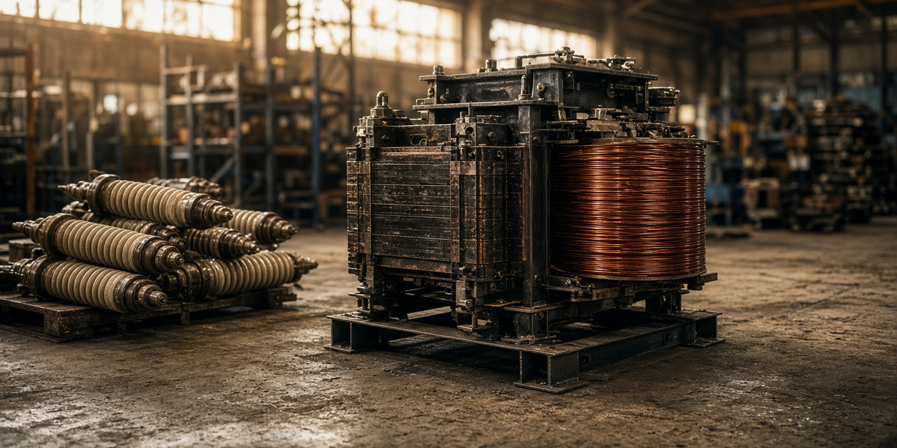

# standard-iron

A rebuilt transformer that is restored to its original nameplate cannot be stocked. The next order with a different bushing waits on a new unit.

This program takes one yard and one order book and fills the book three ways. It is offline and deterministic. Prices and weeks are the fixture, not a quote from a shop.

**bespoke-reman** uses a retired unit only when the kVA, both voltages, and impedance already match the ordered SKU, and the failure can pass a factory test. Shelf stock is not a bespoke nameplate. Lead time is that unit's own shop weeks. There is no learning curve.

**standard-iron** rebuilds onto a published interface. An exact nameplate qualifies. So does a different voltage, when `interface_ok` is true, because the bushings are replaced. A unit already on the shelf ships in 8 weeks. The first build of a SKU takes 52 weeks, half of the 104-week new-unit lead. Each later build of that same SKU is 6 weeks faster, and the curve stops at 34. Orders are filled tightest need first. Each order takes the soonest iron that still arrives on time.

**new-build** offers every order a new unit at 104 weeks.

A core-melt cannot pass the factory test, so neither reman policy offers it. Tear-down counts set a learned price: each prior sighting of a recoverable failure takes 5 points off the guild price, capped at 20.

## Run

From the repo root. Python 3.11 or newer. No install and no API key.

```bash
python3 -m standard_iron fixtures/yard.json
python3 -m standard_iron --verbose fixtures/yard.json
python3 -m standard_iron --json fixtures/yard.json
python3 -m unittest discover -s tests -v
```

## Result

```
program yard-2026  orders 7  new 104 weeks  first standard build 52 weeks

policy          shipped  missed  miss_ids
--------------  -------  ------  ------------------------
bespoke-reman         4       3  o6, o1, o5
standard-iron         6       1  o7
new-build             0       7  o6, o1, o2, o7, o3, o4, o5

failure           seen   guild_usd  learned_usd  quote
----------------  ----  ----------  -----------  -----
bushing              3      260000       234000  yes
core-melt            1           0            -  no
gasket-leak          5      200000       160000  yes
insulation-age       3      340000       306000  yes

standard-iron ships 6/7 orders (bespoke-reman 4/7, new-build 0/7). The 20-week SI-50 order ships from the shelf in 8 weeks; bespoke's fastest exact nameplate is 36 weeks.
```

The 20-week SI-50 order is the storm. Only the shelf unit makes it. Bespoke's fastest exact 50 MVA nameplate is 36 weeks, so that order misses, and so does the later SI-50 once the three exact donors are gone. Standard also spends the SI-30 shelf on the 16-week order. The next SI-30 build is still week 46 of the learning curve, so the 44-week order misses by two weeks. Bespoke can make that one order, because the donor's own shop time is 40 weeks, and still finishes the book at 4 of 7.

| Policy | What it can stock | Shipped by need week |
|---|---|---|
| bespoke-reman | nothing; exact nameplate only | 4/7 |
| standard-iron | shelf, then a per-SKU learning curve | 6/7 |
| new-build | a new unit at 104 weeks | 0/7 |

Five gasket-leak teardowns price the next one at USD 160000 against a guild price of USD 200000. Core-melt stays unquoted.

## Fixture shape

Voltages are strings, so `34.5` cannot collapse into a float. `on_shelf` means the unit is already the standard SKU. `interface_ok` means the core can take the published bushings even though the original voltage does not match.

```json
{"id": "u9", "kva_mva": 50, "hv_kv": "220", "lv_kv": "34.5", "z_pct": 10, "failure": "bushing", "shop_weeks": 50, "on_shelf": false, "interface_ok": true}
```

u9 does not fill a bespoke 230 kV order. It does enter the SI-50 build queue.

## License

MIT
